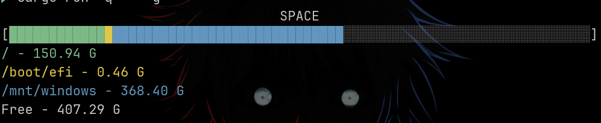
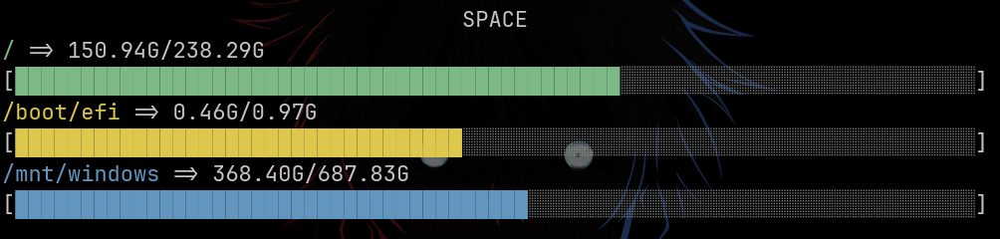

# 🚀 Space - CLI Disk Usage Analyzer

<p align="center">
  
  
  
</p>


<p align="center">
  
</p>

<p align="center">
  
</p>

A lightweight, command-line disk space analyzer written in Rust. Inspired by the traditional `df -h` command, this tool visualizes storage usage through dynamic, color-coded terminal graphics. 

This project was built to explore Rust's system programming capabilities, strict type system, and module architecture.

## ✨ Features

* **📊 Two Visualization Modes:**
  * **Isolated Mode (Default):** Displays individual, color-coded capacity bars for each physical partition.
  * **General Mode (`-g`):** Aggregates all drives into a single system-wide usage bar, complete with a color-matched legend.
* **🖥️ Responsive UI:** Utilizes the `terminal_size` crate to dynamically query the current terminal width and scale the visualization bars down to the character to prevent line-wrapping.
* **🧹 Smart Filtering:** Automatically ignores virtual file systems (like `tmpfs` or `lxcfs`) and only tracks physical block devices located in `/dev/`.
* **🔍 Visual Guarantees:** Custom float-rounding logic ensures that even extremely small partitions (e.g., `/boot/efi`) are always represented by at least one block and are not lost to mathematical truncation.
* **⚡ Zero-Dependency Arg Parsing:** Uses standard `std::env::args()` for lightweight flag routing without bloated CLI frameworks.

## 🚀 Usage

Run the project directly via Cargo. Use the `--` separator to pass arguments to the program rather than Cargo itself.

**1. Isolated Mode (Default)**
```bash
cargo run -q
```

**2. General Aggregated Mode**
```bash
cargo run -q -- -g
```

**🔨 Build for Production**
To compile a fast, standalone binary:
```bash
cargo build --release
# The executable will be located at ./target/release/space
```

## 🛠️ Tech Stack

* **Rust** 🦀 (Standard Library for Argument Parsing & Env)
* [sysinfo](https://crates.io/crates/sysinfo) - Cross-platform system information retrieval.
* [colored](https://crates.io/crates/colored) - Terminal string styling.
* [terminal_size](https://crates.io/crates/terminal_size) - Dynamic terminal dimensions.
